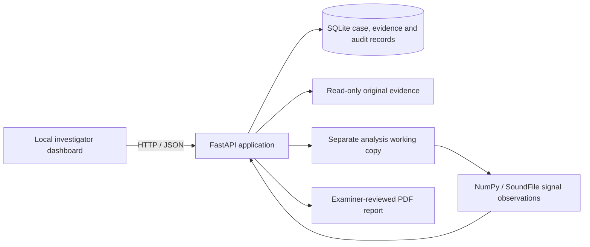

# Audio Evidence Lab

A local-first digital audio forensics prototype for preserving uploaded audio, recording its provenance, inspecting signal-level observations, and exporting a traceable examination report.

> **Forensic limitation:** This prototype does not determine whether a recording is genuine, manipulated, or spoken by a particular person. Its signal checks are explainable screening heuristics, not trained or validated forensic AI. Findings require examiner interpretation and corroboration.

## Architecture



## Project structure

```text
app/
  __init__.py
  main.py             FastAPI routes, evidence workflow, audit events
  signal_analysis.py  Reproducible waveform, spectrum and anomaly screening
  static/
    index.html        Dashboard layout
    app.js            API interactions and chart rendering
    styles.css        Responsive forensic-lab styling
scripts/
  generate_sample.py  Creates a synthetic WAV demonstration file
tests/
  test_signal_analysis.py
requirements.txt
README.md
```

## Implemented workflow

1. Upload WAV, MP3, FLAC, AAC, M4A, or OGG with a case number, examiner, and source description.
2. The server streams the upload to a private local evidence directory, calculates SHA-256 and MD5, and creates a separate working copy. A file over 100 MiB is rejected. Original evidence is marked read-only as a basic safeguard; this is not a substitute for write-once storage or access controls.
3. SoundFile reads formats supported by the installed libsndfile. If a format cannot be decoded, install FFmpeg and add its `bin` folder to `PATH`; the app uses FFmpeg without invoking a shell and limits the operation by timeout.
4. Run signal screening for waveform, spectrum, silence, clipping, amplitude discontinuities, and possible spectral changes. The UI displays observations and their timestamps, not verdicts.
5. Review the event history and download a PDF report. The report labels observations as automated and includes limitations for examiner review.

All timestamps are UTC ISO-8601. Local mode has no login or multi-user authorization: bind only to localhost and do not expose this prototype to a network or use it as an evidence repository. SQLite and local file permissions are for demonstration, not production chain-of-custody controls.

## Windows setup

Use Python 3.10 or later:

```powershell
py -3 -m venv .venv
.\.venv\Scripts\Activate.ps1
python -m pip install --upgrade pip
python -m pip install -r requirements.txt
python -m uvicorn app.main:app --host 127.0.0.1 --port 8000
```

Open <http://127.0.0.1:8000>. To choose a data directory, set `$env:AUDIO_FORENSICS_DATA_DIR` before starting the server. Keep that directory access-restricted and backed up according to your lab policy.

Generate a clearly synthetic demonstration file:

```powershell
python scripts\generate_sample.py
```

Run tests:

```powershell
python -m pytest
```

## API

- `GET /api/health` — local service status.
- `POST /api/evidence` — multipart upload (`file`, `case_number`, `examiner`, optional `source`).
- `GET /api/evidence` — list evidence records.
- `GET /api/evidence/{id}` — record and latest signal observations.
- `POST /api/evidence/{id}/analyze` — run the documented signal checks against the working copy.
- `GET /api/evidence/{id}/events` — append-only application event history.
- `GET /api/evidence/{id}/report.pdf` — downloadable examiner-review PDF.

FastAPI's interactive API documentation is available at `/docs`.

## Analysis and limitations

The analysis uses deterministic measurements: 20 ms RMS frames, a 0.5 second silence threshold, near-full-scale sample counts, RMS jumps, and a coarse log-frequency STFT view. Thresholds are screening choices, not validated decision boundaries. Compression, recording equipment, edits, speech content, and environment can produce similar observations. No probability of tampering, calibrated confidence, speaker identity, transcript, or deepfake classification is generated.

No datasets, model weights, training results, or benchmark scores are bundled. Synthetic sample audio is for exercising the interface only and must not be presented as forensic validation. A future research phase should add licensed, documented datasets, speaker/source-independent splits, baseline and advanced models, calibration, error analysis, and independent testing before reporting model performance. ASR, diarization, speaker comparison, and synthetic-speech detection are intentionally not simulated.

## Evidence-handling notes

- The uploaded original is kept separately from its working copy; both SHA-256 values are recorded.
- The application does not modify either copy during analysis. Decoders may create temporary decoded data for supported formats; these are not evidence originals.
- Events are stored in SQLite and exposed for review. A local database is not tamper-proof, signed, or independently timestamped.
- The report is a draft artifact. An examiner must verify the hashes, methodology, observations, and conclusions before use.
- Never upload sensitive evidence to an untrusted machine. For real casework, use an approved, access-controlled forensic environment and validated tools.
